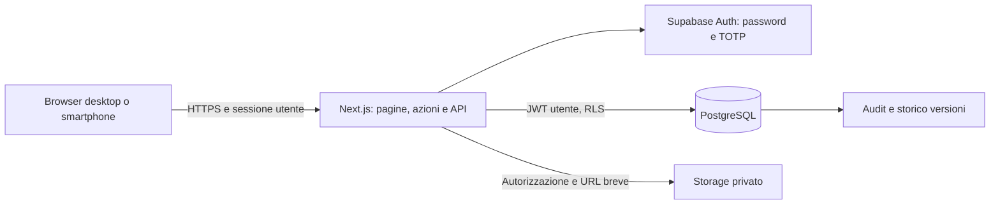

# Architettura

GIANNO PEOPLE è una web app responsive. Next.js App Router rende le schermate sul server e gestisce form e API; i grafici sono componenti client. Supabase fornisce identità, MFA, PostgreSQL e Storage privato. Il browser riceve una chiave pubblica di progetto e la propria sessione, mai una chiave amministrativa.



```text
src/
  app/
    (workspace)/        dashboard e moduli HR autenticati
    auth/               callback, recupero password e MFA
    api/                documenti, fotografie, export CSV, fascicolo PDF
    actions.ts          scritture server validate
  components/           interfaccia, grafici e modelli di valutazione
  domain/               calcoli, date italiane, parser cedolini e PDF annuale
  lib/                  sessione Supabase, autorizzazioni e paginazione
supabase/
  migrations/           schema, trigger, relazioni e RLS
  tests/                stub infrastrutturali e test PostgreSQL reali
scripts/                avvio ripetibile Supabase locale
tests/                 unità, autorizzazioni, browser e integrazione locale
docs/                  gestione operativa, privacy e risultati di collaudo
```

## Confini dei dati

Le tabelle operative contengono solo dati necessari al lavoro di sede. Contatti riservati, contratti, assenze amministrative, documenti e paghe sono separati. Il responsabile legge i collaboratori delle sedi assegnate, le proprie valutazioni e i dati operativi autorizzati; non legge stipendi o causali protette. HR legge valutazioni soltanto con autorizzazione esplicita. Direzione e HR richiedono MFA per accedere alle risorse riservate. Le policy ricontrollano il profilo attivo ad ogni operazione.

Le azioni server validano forma e autorizzazioni; RLS e trigger proteggono anche richieste dirette al database via API. I trigger calcolano i punteggi, impediscono modifiche alle schede convalidate e mantengono lo storico. Le versioni dei criteri sono immutabili. Le tabelle relazionali di criteri e punteggi sono sincronizzate dai parent validati e non accettano scritture applicative dirette.

## File e calcoli

Il caricamento documenti usa un percorso univoco, un hash e un bucket privato. I cedolini vengono estratti localmente e salvati in bozza; un operatore deve verificarli. L'estrazione non effettua chiamate AI né interpreta lordo o imponibile come netto. Il netto non riconosciuto e il periodo ignoto restano da compilare. I PDF scansiti richiedono inserimento manuale finché non sarà introdotto OCR locale.

I report PDF per colloqui escludono per impostazione predefinita intere sezioni retributive e amministrative, anche dalle query. Le medie indicano i mesi effettivi e separano le mensilità aggiuntive. Note e assenze non sono input del calcolo dei punteggi. Nessun processo decide sanzioni, promozioni o cessazioni.

## Rilascio e servizi esterni

Il collaudo locale Docker e un progetto Supabase gestito sono ambienti distinti. Le chiavi del collaudo non vanno usate in produzione. Prima dell'uso reale verificare SMTP, dominio, TLS, regione UE, DPA, backup e restore, autorizzazioni, log infrastrutturali e procedure privacy. Gli audit applicativi coprono le operazioni previste dall'app; i log del fornitore devono coprire accessi infrastrutturali e riuso dei link firmati.
